# Map styles (Task 10)

Three MapLibre styles for picking a direction: **Topo**, **Light** (minimal-light), **Dark**.
The app opens on **Topo** (`MapStyle.Default`); a segmented control at the top switches styles live.

- Templates: `app/composeApp/src/commonMain/composeResources/files/styles/{topo,minimal-light,dark}.json`
- Generated by `scripts/build-map-styles.py`, which holds the palettes and the shared trail/status layers.
  Edit the script and re-run it; don't hand-edit the JSON.
- `base.json` / `MapStyle.BASE` (Task 9) is gone. Its screenshots (`base-*.png`) are kept as the
  starting point to compare against.

## Recommendation: Topo as the default

1. **Status reads first.** The trails are the only saturated color on the map. The land is a cool
   lichen gray-green, the water is a muted Puget Sound teal, and roads are white. The four
   statuses stand out against all of it.
2. **Relief.** Bainbridge is 0–130 m of ravines and ridges, and its trails follow them.
   Hillshade plus 5 m contours (25 m index contours, labeled from z14) show why a trail is
   hard. A flat basemap hides that. The relief is what keeps the map from looking generic,
   and the owner listed a generic map as a failure.
3. **A look of its own.** Concentric "water lines" off the coastline, as on old nautical
   charts, suit an island and a ferry town. Default basemaps don't do this. It's pure style
   (line offsets on the land outline) and costs no extra data.
4. **Color-blind check passes** (see below), on both platforms.

Suggested follow-up: use **Dark** automatically when the OS is in dark mode. Offer **Light**
as a "focus" option for checking progress, where the island is just a shape and the trails
are the ink.

## Palette

Status colors run from cool and quiet to hot and saturated as a trail gets closer to done.
The hues are the same in all three styles; Dark gets brighter versions.

| Role | Topo | Light | Dark |
|---|---|---|---|
| Land | `#ECEFE6` | `#E8EBE7` | `#1D2925` |
| Water / background | `#9EBFC7` | `#FBFCFC` | `#0E1F27` |
| Woods / parks | `#D4E0C6` | `#E1E6DE` | `#21312A` |
| Open green (grass, golf) | `#E2E9D7` | `#E4E8E1` | `#22302A` |
| Coastline / water lines | `#7FA2AB` / `#6F97A2` | `#9DB5BF` | `#2C4450` / `#2E5564` |
| Contours / labels | `#9C845C` / `#86704C` | (none) | `#5F7A6B` / `#7D978A` |
| Hillshade | opacity .36→.26 | (none) | opacity .30→.22, brightness max .55 |
| Roads (minor / major / SR-305) | `#FFFFFF` / `#FFFFFF` / `#F4E7C0`, casing `#C3C7BC` | `#F7F8F6` / `#FFFFFF` / `#FFFFFF` | `#34413B` / `#46544D` / `#56625A` |
| **Done** (`complete`) | `#9B1FA8` | `#931B9F` | `#D45CFF` + glow |
| **Nearly done** (`nearly_done`) | `#E2562A`, casing `#5A1F0C` | `#DE4F22`, casing `#4A1A09` | `#FF7B47`, casing `#0B1410` |
| **Partway** (`partway`) | `#C98A00` | `#C08300` | `#F0B43C` |
| **Not started** (`not_started`) | `#6E6A64` | `#66625C` | `#A9A49B` |
| Not counted (`included == false`) | `#7D8679` @ .75 | `#9AA19A` @ .85 | `#5E6E66` @ .8 |
| Trail / place / water labels | `#2F3A33` / `#46504A` / `#4C7682` | `#3A4247` / `#5F676C` / `#6F8E9A` | `#DCE6E1` / `#A9B8B1` / `#5F8694` |

The switcher and legend chrome follow the style: a white pill with ink `#26302B` for selection
on the light styles, `#13201B` with `#DCE6E1` on Dark. The legend colors in
`StyleSpikeScreen.kt` copy the script's colors by hand (spike only).

## Status encoding (not color alone)

The fake `status` is computed in the style from the segment id:
`floor(int(id[4:]) / 7) % 4` maps to complete / partway / not_started / nearly_done. Runs of 7
consecutive ids share a status, so connected stretches show one state. Only `included == true`
segments get a status.
**Real status will come from app state**: feature-state keyed by segment id, or a client-side
GeoJSON overlay of walked segments. When that lands, replace the `STATUS` expression in the script.

| Status | Pattern | Width z11 / z13 / z15 / z17 (px) | Extra |
|---|---|---|---|
| `complete` | solid | 1.8 / 3.2 / 5.6 / 9.0 (thickest) | Dark: soft glow (blur, 35 %) |
| `nearly_done` | solid | 1.3 / 2.3 / 3.8 / 6.2 | dark casing +2.2 px |
| `partway` | long dash 2.6:1.4 (× width), butt caps | 1.2 / 2.0 / 3.2 / 5.0 | |
| `not_started` | round dots (0:1.9 × width) | 1.1 / 1.7 / 2.6 / 4.0 (thinnest) | |
| not counted | hairline, low contrast, from z12 | 0.4 / 1.0 @ z15 / 1.8 @ z18 | by category, see below |

Every counted segment also sits on a land-colored halo (+3 px), so trails stay separate from
contours and roads.

Categories:
- `multi_use_path` (counted) gets a wide pale "paved" band under the status line.
- Not-counted segments are split by category: `seasonal_closed` is a short brick-red dash,
  `beach_access` is a teal hairline, `easement` is a long dash, and everything else (`informal`,
  `connector`, …) is a plain hairline.

## Typography

No glyphs are bundled. Labels use Protomaps' free, keyless glyph host
(`https://protomaps.github.io/basemaps-assets/fonts/{fontstack}/{range}.pbf`), so they only
appear online. **Tested offline** (Android airplane mode, app data cleared): the map, trails and
status all render, labels are absent, and the app doesn't crash.

- **Noto Sans Medium**: trail names (along the line, z14+, offset off the line, max angle 25°)
  and places (towns, hamlets and neighbourhoods at their `min_zoom`; OSM farms tagged as
  localities are filtered out).
- **Noto Sans Italic**: water names and contour elevations ("100 m"), following the usual map
  convention of italic for water and relief.
- Noto is the only family the free host offers, so it was a constraint, not a choice. Before
  release: bundle glyph PBFs (built with font-maker) for offline labels. That's also the moment
  to pick a family with more character, e.g. a humanist sans for names and its italic for water.

## Color-blind check

Run `python3 scripts/cvd-simulate.py deutan|protan|tritan <png>…`. It applies the Machado 2009
matrices at severity 1.0 in linear RGB and writes `<name>-<kind>.png`.

What changed because of it: the first draft used **magenta** for done (`#A8146C`, Dark `#FF4FA6`).
Under deuteranopia it turned slate gray / light gray, the same family as not-started, so done
lost its pop and only the line pattern still told them apart. I switched to **violet**
(`#9B1FA8` / `#931B9F` / `#D45CFF`). It stays a vivid blue under both deutan and protan, and
not-started moved to a neutral warm gray.

Result (deutan + protan, all styles, z15):
- Done = blue, solid, thickest. Clearly different from everything else.
- Not started = gray dots. Different by color and pattern.
- Nearly done vs partway both fall into olive/gold. They're told apart by pattern (solid with a
  dark casing vs. long dashes) and by lightness (nearly done is darker). They stay readable,
  but this is the weakest pair. If the owner wants more separation, push partway lighter, toward
  yellow.
- Not counted stays a faint hairline in every simulation.

## Runtime switching

`rememberMapState(baseStyle = …)` in maplibre-compose 0.20 calls `updateBaseStyle(baseStyle)` in
a `SideEffect` on every recomposition (`MapRuntime.kt`). Only the initial *camera* is used just
once. When `style` changes, `produceState` keeps the old `Ready` value until the new template is
rendered, then the map restyles in place and keeps the camera. Verified: every screenshot below
was taken **after** a live switch. On Android that was real taps on the segmented control. On iOS
the app launched in another style and auto-switched after 5 s (`switchTo` launch argument),
because the simulator can't be tapped from a script.

Spike launch options (screenshots only): Android
`adb shell am start -n com.bainbridgetrails.app/.MainActivity --es style TOPO --es lat 47.655 --es lon -122.548 --es zoom 15`.
iOS: `xcrun simctl launch booted com.bainbridgetrails.app style=DARK lat=47.655 lon=-122.548 zoom=15 switchTo=TOPO switchAfterMs=5000`.

## Screenshots

Android: temp AVD (API 35 arm64, Pixel 7 profile), deleted afterwards. iOS: iPhone 17 Pro
simulator (iOS 26.3). Island view is z12 at the island center; the z15 shots are Grand Forest
(47.655, -122.548). PNGs are palette-quantized (256 colors, dithered) to keep the repo small;
the CVD sims were made from the full-color captures.

| | Topo | Light | Dark |
|---|---|---|---|
| Android z12 | 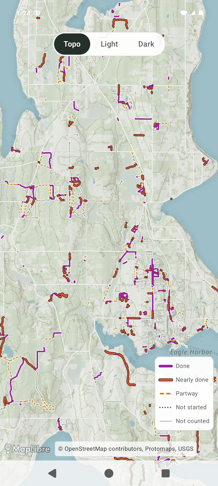 | 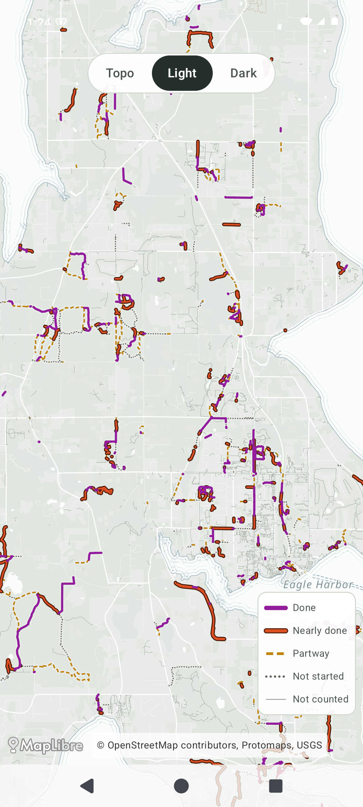 | 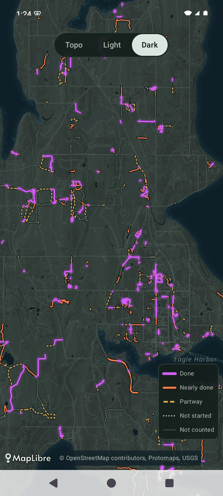 |
| iOS z12 | 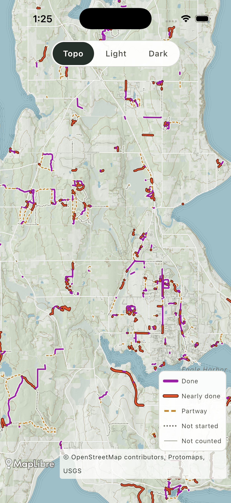 | 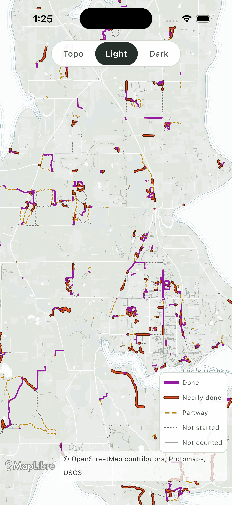 | 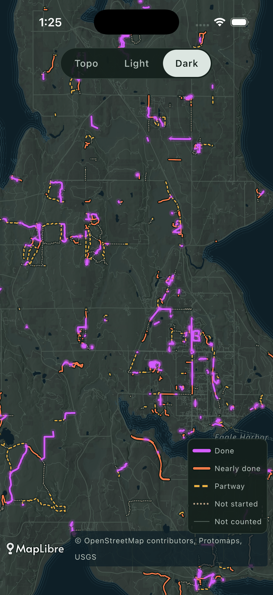 |
| Android z15 | 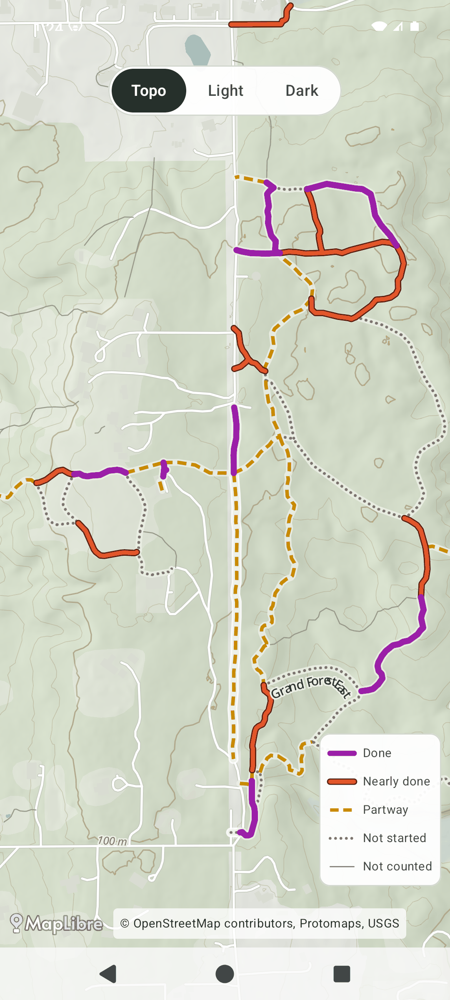 | 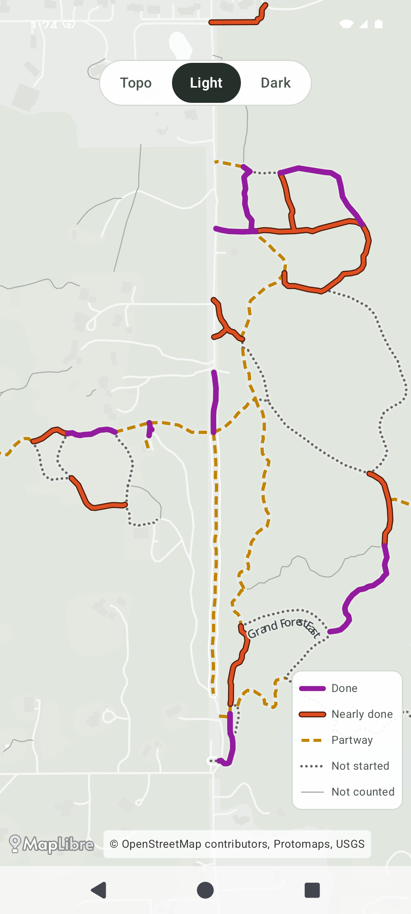 | 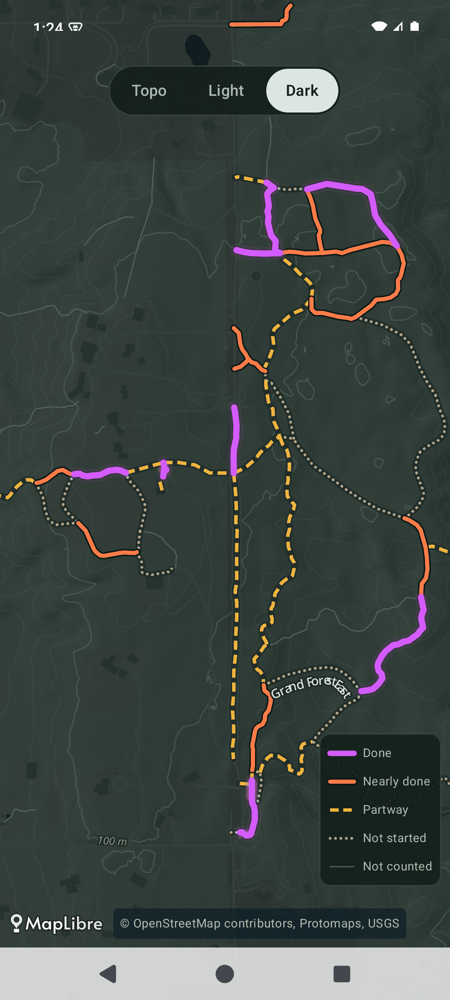 |
| iOS z15 | 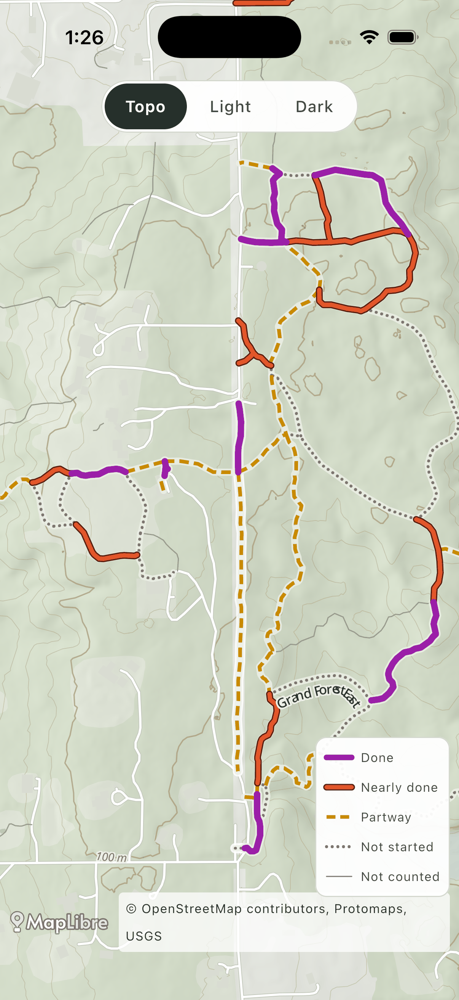 | 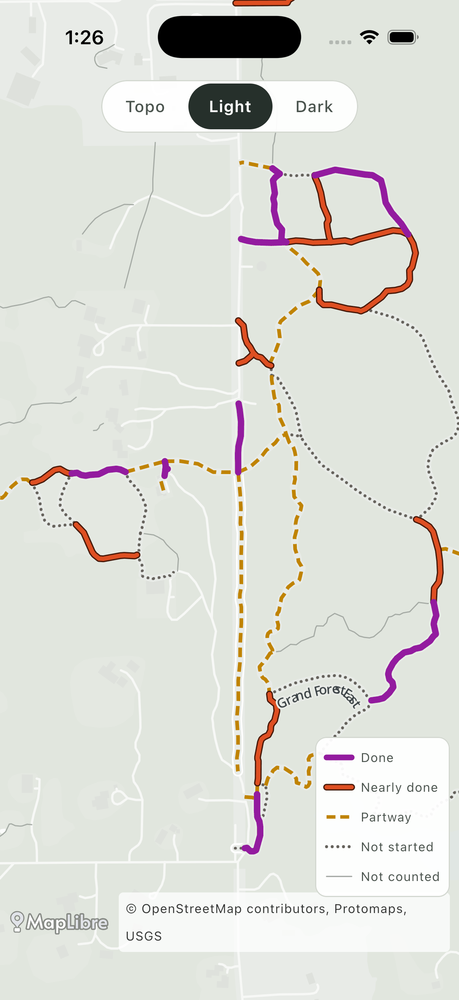 | 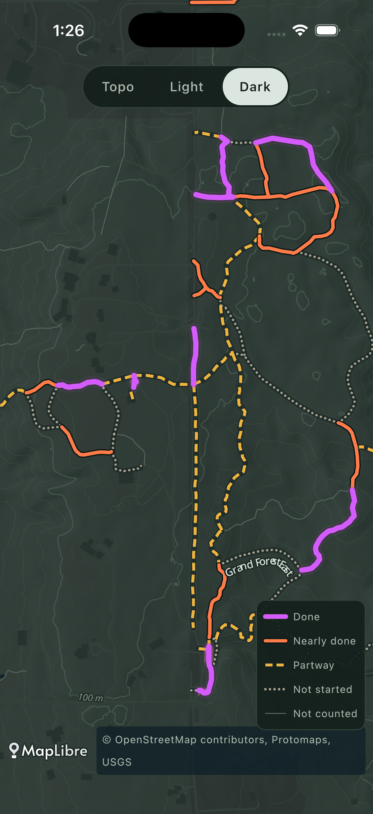 |
| Android z15 deutan | 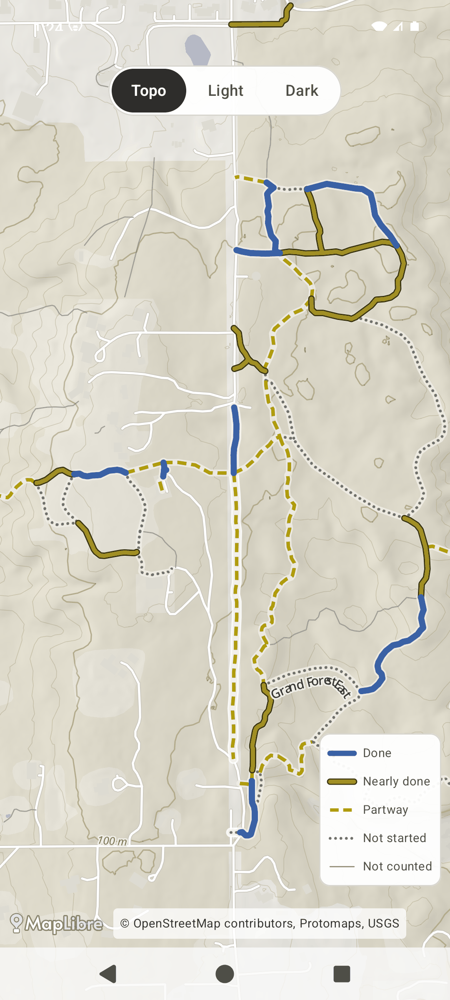 | 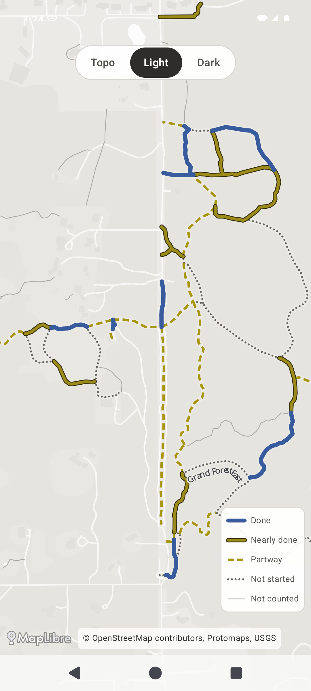 | 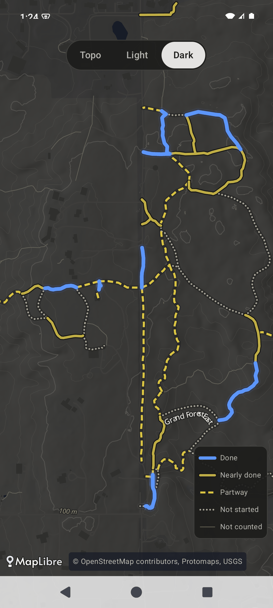 |
| iOS z15 deutan | 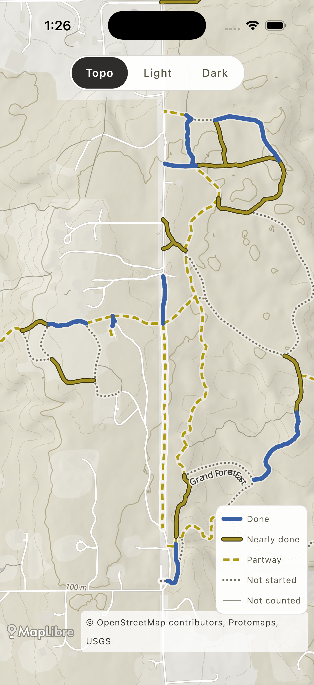 | 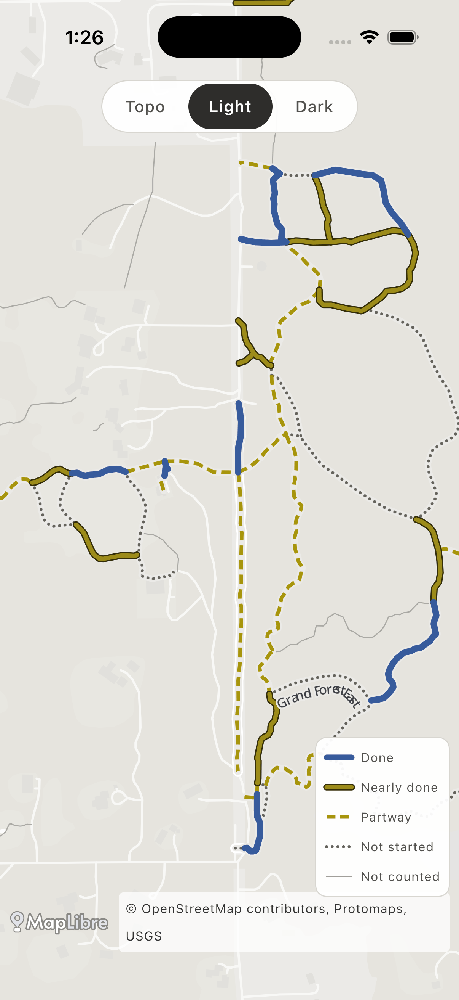 | 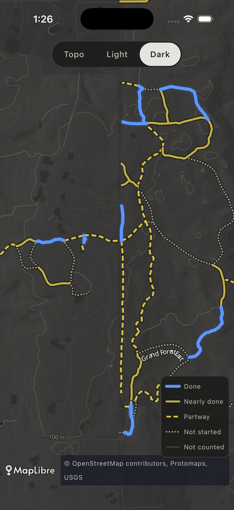 |
| protan (spot checks) | 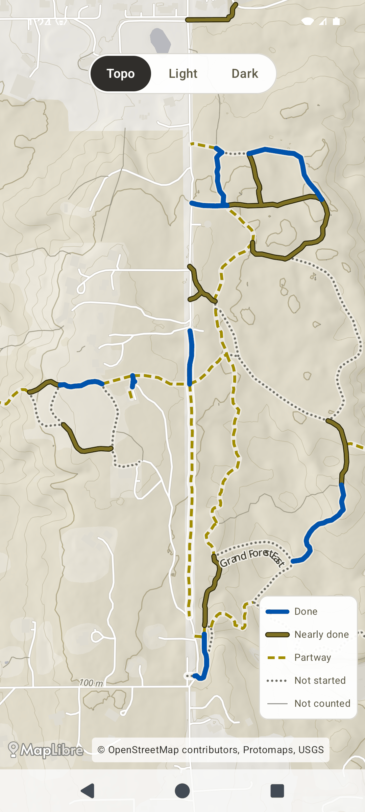 | 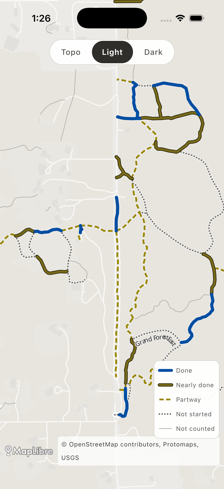 | 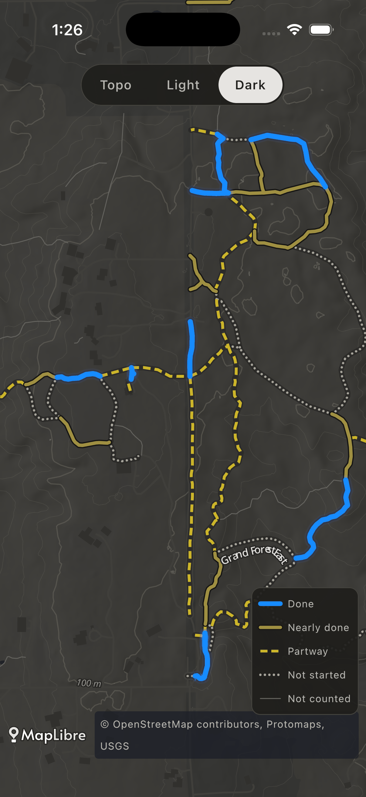 |

## Known limits / next

- At z12 the counted network is many short fragments, and some trail names repeat per segment.
  Real labels should come from merged trail lines (`trails.json` / a label layer at build time),
  not from segments.
- The basemap `landuse` patchwork (OSM woods vs residential) is still visible at z12. A
  pipeline-side landcover generalization (or a single forest-canopy layer) would calm it.
- The legend and switcher are spike UI and not designed for release.
- Glyphs are online-only (see Typography).
